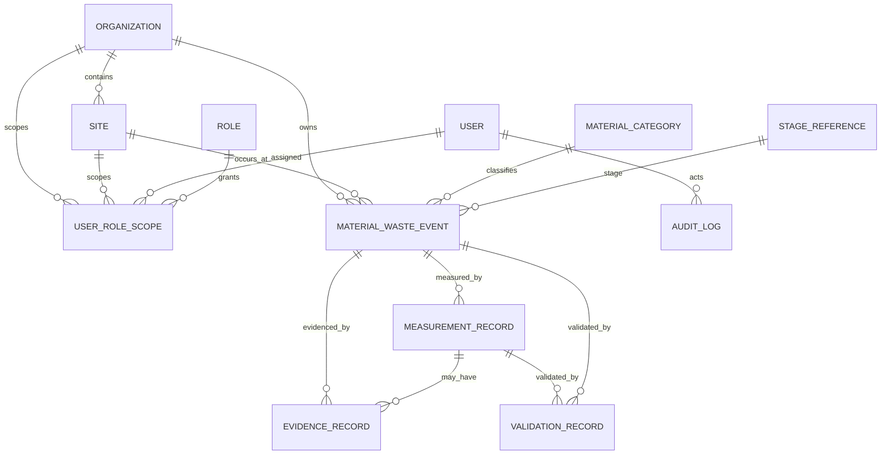

# FoodWaste Intelligence (FWI)
## FWI-ARCH-001 — System & Data Architecture v0.1

> **Status:** CONTROLLED WORKING BASELINE / PROVISIONAL  
> **Purpose:** Arsitektur logis untuk prototipe sintetis dan pengembangan MVP P0.  
> **Not production authorization:** Dokumen ini bukan persetujuan deployment lapangan, bukan integrasi resmi BGN, dan bukan pengesahan metodologi lapangan.  
> **Product baseline:** `docs/product/PRD-v0.1.md`  
> **Domain baseline:** `docs/domain/waste-event-measurement-v0.1.md`  
> **Existing prototype:** `src/fwi/domain/` + `tests/test_domain_validation.py`

---

## 1. Tujuan

Dokumen ini menerjemahkan PRD FWI v0.1 menjadi arsitektur sistem dan data yang cukup tegas untuk memandu Codex, Antigravity, dan reviewer manusia tanpa memaksa keputusan teknis yang masih terbuka.

Arsitektur harus:
1. menjaga satu identitas event yang stabil;
2. memisahkan event, measurement, validation, transfer, dan disposition;
3. mencegah double counting;
4. mempertahankan mass basis, provenance, status mutu data, dan lineage;
5. mendukung auditability;
6. memungkinkan ekspor yang dapat direkonsiliasi ke record sumber;
7. tetap stack-agnostic sampai keputusan teknis ditutup melalui ADR.

---

## 2. Hierarki Sumber Keputusan

Jika terjadi konflik, implementasi **tidak boleh menebak**. Gunakan urutan berikut:

1. keputusan domain/metodologi yang sudah dikunci dalam FWI-02/FWI-03;
2. PRD v0.1;
3. kontrak domain `waste-event-measurement-v0.1.md`;
4. dokumen arsitektur ini;
5. task/issue implementasi aktif.

Jika sumber yang lebih tinggi tidak cukup, status harus `OPEN DECISION` dan implementasi tidak boleh mengubahnya menjadi keputusan final secara diam-diam.

---

## 3. Scope Arsitektur

### 3.1 P0 — dicakup sekarang
- organization & site;
- users, roles, permissions;
- minimum master data;
- material/waste event;
- measurement;
- validation/data-quality review;
- evidence metadata;
- audit trail;
- export CSV/XLSX;
- summary/data-quality views.

### 3.2 P1 — disiapkan boundary-nya, belum diimplementasikan penuh
- receiving/lot/batch;
- material-flow links;
- distribution/serving context;
- transfer;
- disposition & rescue;
- operational dashboards.

### 3.3 P2 — tidak diimplementasikan pada P0
- KPI engine penuh;
- financial intelligence;
- recommendation/decision-support automation;
- advanced analytics.

`OP-08`, `FI-02`, dan `NI-03` tetap **HELD / disabled**.

---

## 4. Architectural Style

### 4.1 Baseline
**Modular monolith** untuk MVP awal.

Alasan:
- domain masih berubah dan perlu mudah direfaktor;
- transaksi event/measurement/audit memerlukan konsistensi;
- lebih mudah diuji dan dioperasikan daripada microservices;
- tetap dapat dipisah menjadi service di masa depan bila ada kebutuhan nyata.

### 4.2 Lapisan logis

```text
Web UI
  |
  v
Application/API Layer
  |
  +-- Access & Identity
  +-- Master Data
  +-- Event Service
  +-- Measurement Service
  +-- Validation Service
  +-- Audit Service
  +-- Export Service
  |
  v
Domain Layer
  |
  +-- Event rules
  +-- Measurement rules
  +-- Data-quality rules
  +-- Lineage / no-double-count controls
  |
  v
Persistence Layer
  |
  +-- Relational Database
  +-- Evidence/Object Storage
```

Business rules tidak boleh disimpan hanya di UI.

---

## 5. Komponen Sistem P0

### 5.1 Web UI
Tanggung jawab:
- login;
- role-based navigation;
- quick event entry;
- measurement entry;
- review queue;
- validation feedback;
- record detail/lineage;
- export screen;
- data-quality summary.

UI tidak boleh menghitung formula domain secara independen dari backend/domain layer.

### 5.2 Application/API Layer
Menyediakan use cases:
- create/update allowed master data;
- create event;
- add measurement;
- validate/review record;
- attach evidence metadata;
- view lineage;
- export dataset;
- query data-quality summaries.

### 5.3 Domain Layer
Sumber aturan bisnis P0. Tidak tergantung framework web atau database.

Domain prototype yang sudah ada menjadi starting point:
- `MaterialWasteEvent`
- `MeasurementRecord`
- `ValidationRecord`
- decimal/mass validation

### 5.4 Persistence Layer
Menyimpan data terstruktur dan hubungan referensial.

**Keputusan final DB engine: OPEN.**  
Baseline arsitektur hanya mensyaratkan **relational database** dengan:
- foreign keys;
- constraints;
- transaction support;
- migrations;
- indexing;
- auditability;
- backup/restore.

### 5.5 Evidence Storage
Evidence file tidak disimpan sebagai blob besar di tabel domain bila dapat dihindari.

Database menyimpan metadata seperti:
- `evidence_id`;
- related entity;
- storage key/path;
- media type;
- checksum;
- uploaded_at;
- uploaded_by.

Object/file storage provider tetap `OPEN`.

---

## 6. P0 Data Model

### 6.1 Identity & Access
**Organization**
- `organization_id` PK
- `name`
- `status`
- timestamps

**Site**
- `site_id` PK
- `organization_id` FK
- `name`
- `timezone`
- `status`

**User**
- `user_id` PK
- identity reference
- status

**Role**
- `role_id` PK
- code/name

**UserRoleScope**
- `user_id`
- `role_id`
- optional `organization_id`
- optional `site_id`

Role merupakan fungsi aplikasi, bukan jabatan universal SPPG.

### 6.2 Minimum Master Data
**MaterialCategory**
- `material_category_id`
- code
- label
- status
- provenance/version

**StageReference**
- `stage_code`
- label
- status

Vocabulary final tidak boleh diciptakan oleh implementer bila belum ditetapkan sumber.

### 6.3 Material/Waste Event
**MaterialWasteEvent**
- `event_id` PK — canonical identity
- `organization_id` FK
- `site_id` FK
- `event_type`
- `stage_code`
- `process_step`
- `operation_date`
- `occurred_at`
- `recorded_at`
- `captured_by`
- `material_category_id`
- regulatory/classification fields sesuai baseline
- event status
- created/updated metadata

`event_id` dan istilah lama `waste_event_id` menunjuk identitas konseptual yang sama. Implementasi baru menggunakan **satu canonical key** dan tidak membuat ID event kedua.

### 6.4 Measurement
**MeasurementRecord**
- `measurement_id` PK
- `event_id` FK
- `measured_at`
- original gross/tare/net fields as applicable
- original unit
- canonical mass kg when derivable
- `mass_basis`
- `measurement_method`
- `observation_status`
- provenance
- precision
- instrument/sample metadata when applicable
- recorded metadata

Repeated measurement:
- tetap event yang sama;
- tidak otomatis dijumlahkan;
- tidak otomatis mengganti record lama;
- reporting selection membutuhkan reconciliation policy yang eksplisit.

### 6.5 Validation
**ValidationRecord**
- `validation_id` PK
- target entity type/id
- `validation_status`
- rule/check reference
- reviewer/system actor
- reason/comment
- `recorded_at`

Validation history terpisah dari observation record.

### 6.6 Evidence
**EvidenceRecord**
- `evidence_id` PK
- target entity type/id
- storage reference
- filename/media type
- checksum
- uploaded_at/by
- status

### 6.7 Audit
**AuditLog**
- `audit_id` PK
- actor
- action
- entity type/id
- timestamp
- reason if required
- before/after reference or structured diff
- correlation/request id where available

Audit log tidak boleh menjadi mekanisme tersembunyi untuk mengubah data sumber.

### 6.8 Export
Export tidak perlu tabel bisnis sendiri pada MVP kecuali kebutuhan job history muncul.

Jika histori ekspor dibutuhkan:
**ExportJob**
- export_id
- filters/scope
- requested_by
- requested_at
- completed_at
- status
- checksum/file reference

---

## 7. ERD Konseptual P0



ERD ini **P0 conceptual ERD**, bukan schema SQL final.

---

## 8. Future P1 Relationships

P1 harus ditambahkan sebagai entitas terpisah dan tidak mengubah event generation menjadi sekadar movement.

Calon entitas:
- `ReceivingLot`
- `ProductionBatch`
- `ServingSession`
- `TransferRecord`
- `DispositionRecord`
- `RescueRecord`

Aturan:
- transfer bukan generation baru;
- disposition bukan generation baru;
- rescue tidak boleh dinyatakan aman tanpa safety decision;
- unreconciled difference tidak otomatis waste.

---

## 9. Data Flow P0

### 9.1 Create event
```text
User
 -> Web Form
 -> API/Application Service
 -> Permission Check
 -> Domain Validation
 -> Persist Event
 -> Audit Log
 -> Response
```

### 9.2 Add measurement
```text
User
 -> Event Detail
 -> Measurement Form
 -> Existing Event Check
 -> Decimal / unit / mass-basis validation
 -> Persist Measurement
 -> Audit Log
 -> Validation Queue / status
```

### 9.3 Review
```text
Reviewer
 -> Review Queue
 -> Source Record + Evidence + History
 -> Validation Decision
 -> ValidationRecord
 -> AuditLog
```

Reviewer tidak mengubah source record secara diam-diam.

### 9.4 Export
```text
Authorized User
 -> Export Filters
 -> Permission Check
 -> Query Canonical Records
 -> Include validation + lineage metadata
 -> CSV/XLSX
```

Export harus dapat direkonsiliasi kembali ke record sumber.

---

## 10. Correction & Immutability Strategy

### 10.1 Event identity
`event_id` immutable dan tidak digunakan ulang.

### 10.2 Measurement
Original measurement tidak dihapus secara diam-diam.

Kebijakan final untuk:
- supersede;
- void;
- correction;
- selection for reporting

masih **OPEN DECISION** sampai reconciliation policy ditutup.

### 10.3 Audit
Setiap perubahan substansial harus mengetahui:
- siapa;
- kapan;
- apa berubah;
- alasan bila diperlukan;
- nilai/reference sebelumnya.

---

## 11. API Boundary v0.1

API contract detail belum dikunci, tetapi boundary berikut direkomendasikan:

```text
/auth
/organizations
/sites
/users
/roles
/master-data
/events
/events/{id}/measurements
/events/{id}/evidence
/measurements/{id}/validations
/review
/exports
```

REST vs alternative transport: **OPEN DECISION**.  
Tidak ada integrasi API pemerintah yang diasumsikan tersedia.

---

## 12. Authentication & Authorization

### 12.1 Authentication
Provider/method belum dikunci.

Wajib:
- authenticated identity;
- secure session/token handling;
- revocation/logout capability;
- no credentials in repository.

### 12.2 Authorization
Baseline: role + scope.

Contoh fungsi:
- operator/input;
- reviewer;
- site manager/read-review;
- administrator.

Permissions dievaluasi pada backend, bukan hanya dengan menyembunyikan tombol UI.

---

## 13. Data Quality Architecture

Data quality bukan hanya dashboard.

Pipeline:
```text
Capture
 -> Structural Validation
 -> Domain Validation
 -> Quality/Completeness Checks
 -> Review/Validation Record
 -> Eligible / Blocked / Needs Review
```

`missing`, `measured_zero`, `not_measured`, estimate, dan blocked tidak boleh disamakan.

KPI/ratio tidak boleh dihitung bila required inputs, basis, period, population, atau validation state tidak cocok.

---

## 14. Export & Interoperability

P0:
- CSV/XLSX export;
- stable identifiers;
- explicit unit and mass basis;
- validation state;
- provenance/lineage fields;
- timestamps.

Future:
- import/export adapters;
- approved API adapters.

Tidak boleh mengklaim kompatibilitas resmi dengan sistem eksternal tanpa contract/authorization yang nyata.

---

## 15. Security & Privacy Baseline

P0 minimum:
- least privilege;
- server-side authorization;
- input validation;
- secure secret management;
- no secret in Git;
- audit log;
- backup/restore plan;
- data minimization;
- synthetic fixtures only during prototype.

Tidak menyimpan identitas siswa individual secara default.

---

## 16. Deployment Topology — OPEN

Logical baseline:

```text
Browser
   |
HTTPS
   |
Web/Application Runtime
   |
   +---- Relational Database
   |
   +---- Object/File Storage
```

Keputusan hosting, managed services, containerization, dan deployment environment belum dikunci.

---

## 17. Database Decision Gate

Database engine **belum final**.

### Required capabilities
- relational integrity;
- transactions;
- migrations;
- decimal/numeric precision;
- indexes;
- timestamps/timezone support;
- unique constraints;
- audit-friendly querying;
- backup/restore;
- mature Python ecosystem.

### Candidate to evaluate
- PostgreSQL as primary production-oriented candidate;
- SQLite may be used for narrow local experiments only if semantic differences are understood.

Pemilihan final harus melalui ADR, bukan asumsi implementation agent.

---

## 18. Technology Decisions Requiring ADR

Buat Architecture Decision Record sebelum mengunci:

- ADR-001: backend framework/runtime;
- ADR-002: relational database engine;
- ADR-003: frontend framework;
- ADR-004: authentication provider/strategy;
- ADR-005: evidence/object storage;
- ADR-006: API style;
- ADR-007: deployment/hosting;
- ADR-008: offline strategy;
- ADR-009: correction/supersession persistence policy.

---

## 19. AI Implementation Contract

Setiap AI coding agent wajib:

1. membaca `AGENTS.md`;
2. membaca PRD dan dokumen arsitektur yang relevan;
3. mengerjakan satu task/issue pada satu waktu;
4. tidak mengubah keputusan `OPEN` menjadi final;
5. tidak menambah dependency tanpa task/ADR;
6. tidak mengaktifkan held KPI;
7. tidak membuat integrasi pemerintah fiktif;
8. tidak menggunakan data nyata;
9. menulis/memperbarui test untuk behavior yang diubah;
10. melaporkan file berubah, tests, dan `git status`.

Jika kebutuhan tidak jelas, agent harus menandai ambiguity, bukan membuat feature baru.

---

## 20. Acceptance Criteria FWI-ARCH-001

Dokumen dianggap cukup sebagai baseline bila:

- [ ] P0 module boundary jelas.
- [ ] Event dan measurement terpisah.
- [ ] Validation dan audit memiliki history terpisah.
- [ ] Relasi organization/site/access jelas.
- [ ] Repeated measurement tidak menyebabkan double counting.
- [ ] Evidence mempunyai storage boundary.
- [ ] Data flow create/review/export terdokumentasi.
- [ ] DB engine tetap OPEN sampai ADR.
- [ ] API pemerintah tidak diasumsikan.
- [ ] P1/P2 tidak tercampur ke implementasi P0.
- [ ] AI contract tersedia.
- [ ] Tidak ada konflik terbuka yang disembunyikan.

---

## 21. Open Decisions

| ID | Decision | Status |
|---|---|---|
| OD-ARCH-01 | Backend framework | OPEN |
| OD-ARCH-02 | Database engine | OPEN |
| OD-ARCH-03 | Frontend framework | OPEN |
| OD-ARCH-04 | Authentication mechanism/provider | OPEN |
| OD-ARCH-05 | Object/evidence storage | OPEN |
| OD-ARCH-06 | REST/other API style | OPEN |
| OD-ARCH-07 | Deployment platform | OPEN |
| OD-ARCH-08 | Offline/sync requirement | OPEN |
| OD-ARCH-09 | Measurement correction/supersession policy | OPEN |
| OD-ARCH-10 | Final controlled vocabularies | OPEN / source-gated |
| OD-ARCH-11 | Performance targets | OPEN / benchmark required |
| OD-ARCH-12 | External integration contracts | OPEN / authorization required |

---

## 22. Recommended Next Work

1. Review and merge this architecture baseline.
2. Produce ADR-001–ADR-005 evaluation before implementation stack is locked.
3. Produce SQL/logical schema only after ADR-002.
4. Produce detailed API contract after backend/API ADR.
5. Produce FWI-UX-001 user flows and screen architecture using the same module boundaries.
6. Start implementation only on a task-specific branch.

---

## 23. Traceability Summary

This baseline is derived from:
- FWI-02 architecture/business-rule baseline;
- FWI-03 methodology/data-quality guardrails;
- FWI-04 MVP product/solution blueprint;
- `PRD-v0.1.md`;
- `waste-event-measurement-v0.1.md`;
- FWI-DEV-001/002/003 implementation history.

Where these sources do not close a technical choice, this document intentionally preserves an `OPEN DECISION`.
